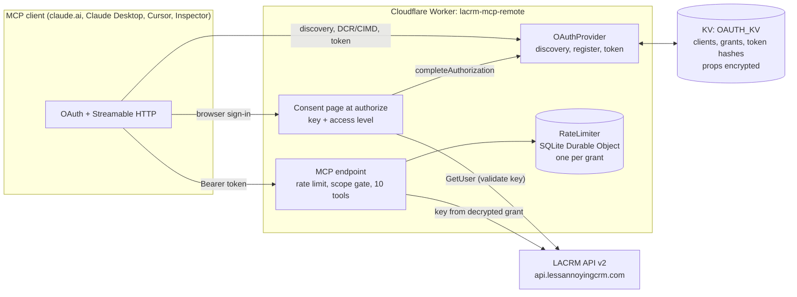

# lacrm-mcp-remote

A remote MCP server for [Less Annoying CRM](https://www.lessannoyingcrm.com/) (LACRM), hosted on Cloudflare Workers, with OAuth 2.1 sign-in. It exposes the same 10 tools as the local [lacrm-mcp](https://github.com/northkeellabs/lacrm-mcp) server (stdio, Python, also by Northkeel Labs), but over Streamable HTTP, so it works as a claude.ai custom connector and in any MCP client that supports remote servers with OAuth.

Independent and unofficial. Not affiliated with, endorsed by or supported by Less Annoying CRM.

**Video walkthrough (62 s, voice + captions):** Claude using this hosted server as a claude.ai connector on a live account with demo data, the read-only mode, OAuth 2.1 sign-in and the test results. GitHub starts videos muted: click the speaker icon in the player to hear the voiceover.


https://github.com/user-attachments/assets/99e98a72-4f8e-41c6-b0c6-46789ef81c4c


## Hosted endpoint

```
https://lacrm-mcp.northkeellabs.com/mcp
```

Northkeel Labs runs this code at that URL. Paste it into any MCP client that supports remote servers with OAuth (see [Connect a client](#connect-a-client)), sign in, and paste your LACRM API key on the consent page. The Worker stores only the encrypted OAuth grant; it keeps no other copy of your key or CRM data. Free, best effort, no SLA, 60 tool calls per minute per connection. To run it on your own Cloudflare account instead, see [Deploy your own](#deploy-your-own).

## Why remote + OAuth

A local stdio server needs every user to install Python, store an API key in a config file and keep the process running on their machine. A remote server is one URL. The user pastes it into claude.ai, Claude Desktop or Cursor, signs in once in the browser, and the client gets a short-lived, revocable token. The API key stays out of the client, out of config files and out of the model's context.

LACRM itself has no OAuth, only API keys. This server bridges the two with a "bring your key, get OAuth" pattern: the Worker is a standards-compliant OAuth 2.1 authorization server (discovery metadata, dynamic client registration, Client ID Metadata Documents, PKCE S256, refresh-token rotation), and its consent page is where the user pastes their LACRM key once. The key is checked with a single read-only LACRM call and then lives only inside the encrypted OAuth grant.

## Architecture



Code map: `src/index.ts` (OAuthProvider wiring), `src/authorize.ts` (consent page), `src/mcp.ts` (protected endpoint), `src/tools.ts` (the 10 tools), `src/lacrm.ts` (API client, retries, error mapping), `src/security.ts` (truncation, untrusted-data wrapper, redaction), `src/ratelimit.ts` (Durable Object).

Built on `@cloudflare/workers-oauth-provider` 1.2.4, `agents` 0.33.0 (`createMcpHandler`) and the MCP TypeScript SDK v2 (`@modelcontextprotocol/server` 2.4.0). The handler is stateless: every request gets a fresh MCP server built for that grant. It serves both 2025-era Streamable HTTP clients and the stateless 2026 protocol from the same `/mcp` endpoint. There is no `/sse` endpoint. `McpAgent` is deprecated as of `agents` 0.33.0, so this uses `createMcpHandler` instead; the only Durable Object is the per-grant rate limiter.

## The auth flow, step by step

1. The client calls `POST /mcp` without a token and gets `401` with `WWW-Authenticate: Bearer resource_metadata=".../.well-known/oauth-protected-resource/mcp", scope="lacrm.read"`.
2. It reads the protected resource metadata (RFC 9728), then the authorization server metadata at `/.well-known/oauth-authorization-server` (RFC 8414).
3. It identifies itself, either with a Client ID Metadata Document URL or by registering at `/oauth/register` (RFC 7591 dynamic client registration).
4. It opens `/authorize` in the browser with PKCE (S256 only), `state` and `resource`. The server rejects unknown clients and any redirect URI that was not registered, and renders those errors locally instead of redirecting.
5. The consent page shows which client is asking (name, verified domain for CIMD clients, redirect host, a warning for local apps), asks for the LACRM API key and an access level: read-only (`lacrm.read`) or read and write (`lacrm.read lacrm.write`).
6. On submit (POST only, CSRF handle bound to a `__Host-` cookie, single use, 10 minutes), the server calls LACRM `GetUser` with the key. A rejected key shows an error and nothing is stored.
7. The server completes the authorization. The key, LACRM user id, granted scopes and a grant id are stored as grant props, encrypted with key material wrapped by the token. The browser is redirected to the client with a code.
8. The client exchanges the code plus PKCE verifier at `/oauth/token` for an access token (1 hour) and a rotating refresh token.
9. Every `/mcp` call is rate limited per grant (60 per minute by default) and scope-checked: a read-only grant sees 6 tools in `tools/list` and any call to a write tool is refused, whether or not it was listed.

## Tools

| Tool | Access | LACRM function | What it does |
| --- | --- | --- | --- |
| `search_contacts` | read | GetContacts | Search contacts and companies by text; summary per record, paged |
| `get_contact` | read | GetContact | Full record for one contact or company |
| `list_contact_notes` | read | GetNotesAttachedToContact | Notes on a contact, paged |
| `list_tasks` | read | GetTasks | Tasks in a date range (max 366 days), optional contact filter |
| `list_pipelines` | read | GetPipelines | Pipelines and their status ids |
| `list_pipeline_items` | read | GetPipelineItems | Items in one pipeline, optional status filter |
| `create_contact` | write | CreateContact | New contact or company; owner defaults to the key's user |
| `add_note` | write | CreateNote | Plain-text note on a contact |
| `create_task` | write | CreateTask | New task, optionally on a contact |
| `update_pipeline_item_status` | write | EditPipelineItem | Move an item to another status; automations are not run |

There are no delete tools. Limits match the Python version: at most 50 results per page with `has_more_results`, text fields truncated at 2,000 characters, lists capped at 50 items, and every response that contains CRM records carries a `data_notice` marking the content as untrusted data, not instructions. Inputs are validated with zod (ids are digit strings, enums, ISO dates, email format, length limits) before any request reaches LACRM.

## Deploy your own

You need a Cloudflare account (the free plan is enough: one Worker, one KV namespace, SQLite-backed Durable Objects) and Node 22+.

```sh
git clone <this repo> lacrm-mcp-remote && cd lacrm-mcp-remote
npm install
npx wrangler login
npx wrangler kv namespace create OAUTH_KV
```

Paste the printed namespace id into `kv_namespaces[0].id` in `wrangler.jsonc` (the id in the repo belongs to the hosted instance and will not work on your account). The repo config serves the Worker on our custom domain, so change the address too:

- Your own domain (the zone must be on the same Cloudflare account): set `routes[0].pattern` to your hostname, for example `mcp.example.com`, and `vars.MCP_RESOURCE` to `https://mcp.example.com/mcp`.
- Or workers.dev: delete the `routes` entry, set `"workers_dev": true`, and set `vars.MCP_RESOURCE` to `https://lacrm-mcp-remote.<your-workers-subdomain>.workers.dev/mcp` (your subdomain is shown in the Cloudflare dashboard under Workers and Pages).

Tokens are bound to this exact URL. Then:

```sh
npm test                 # unit and integration tests in the Workers runtime
npx wrangler deploy
```

No server-side secret is needed: each user's LACRM key arrives through the consent page and is stored only in their encrypted grant. Optional settings are plain vars in `wrangler.jsonc` (`RATE_LIMIT_PER_MINUTE`, default 60). If you later add a secret of your own, use `npx wrangler secret put NAME` in production and `.dev.vars` locally (see `.dev.vars.example`; `.dev.vars` is gitignored).

Local development: copy `.dev.vars.example` to `.dev.vars` (it sets `MCP_RESOURCE` to `http://localhost:8787/mcp`, overriding the production value), then `npx wrangler dev` serves everything at `http://localhost:8787`.

## Connect a client

Use the hosted endpoint `https://lacrm-mcp.northkeellabs.com/mcp` or your own deployment's URL.

- **claude.ai**: Settings > Connectors > Add custom connector. Paste the URL, then Connect. A browser tab opens the consent page; paste your LACRM key (LACRM: Settings > Programmer API) and choose the access level.
- **Claude Desktop**: Settings > Connectors > Add custom connector, same URL and flow as claude.ai.
- **Cursor**: add to `~/.cursor/mcp.json` and enable the server; Cursor opens the browser for sign-in.

  ```json
  { "mcpServers": { "lacrm": { "url": "https://lacrm-mcp.northkeellabs.com/mcp" } } }
  ```

- **MCP Inspector**: `npx @modelcontextprotocol/inspector`, choose transport "Streamable HTTP", enter the URL, and complete its OAuth sign-in flow. Against local dev use `http://localhost:8787/mcp`.

To revoke access, delete or rotate the API key in LACRM. Every grant made with that key then stops working, whatever client holds the token.

## Security

Summary (details and threat model in [SECURITY.md](SECURITY.md)):

- The LACRM key is never accepted as a tool argument, never returned to the client, never logged. Error text from LACRM is redacted before it reaches a tool result.
- Grant props (which hold the key) are encrypted by the OAuth provider; access tokens, refresh tokens and codes are stored only as hashes.
- Consent page: POST only, single-use CSRF handle bound to the browser, all client-supplied text HTML-escaped, `Content-Security-Policy: default-src 'none'; script-src 'none'; frame-ancestors 'none'` with one nonce'd inline style, no JavaScript and no third-party resources, `X-Frame-Options: DENY`, `no-store`.
- Exact redirect URI matching; unknown clients and unregistered redirect URIs are rendered as local errors, never redirected.
- Scope enforcement on every call; per-grant rate limit; writes are never auto-retried on 5xx or timeouts.
- CRM content is bounded and labelled as untrusted to reduce prompt-injection risk. It cannot be made harmless; keep a human in the loop for writes and prefer read-only grants for summarising.

## Tests

Test results, 2026-11-10: `npm test` 50 tests passing (Workers runtime via `@cloudflare/vitest-plugin`, LACRM mocked at `fetch`); `tsc --noEmit` clean; `wrangler deploy --dry-run` succeeds; live end-to-end (`scripts/e2e-live.mjs` against `wrangler dev` and a real LACRM account holding demo data) 20/20 steps passing, and the same 20/20 against the production deployment at `https://lacrm-mcp.northkeellabs.com`. Redacted output: [local](scripts/e2e-live-output.txt), [production](scripts/e2e-live-output-production.txt). Also tested 2026-11-10 as a claude.ai custom connector (read-only grant).

The tests cover each tool's request mapping and output shape, truncation, pagination, the untrusted-data wrapper, error mapping and redaction, retry policy, scope gating (a read grant can neither see nor call write tools, including in a batch), the consent page (bad key, missing or forged CSRF token, unknown redirect URI, unknown client, HTML escaping, deny, single-use handle), rate limiting, and that the key never appears in any response or log line.

To run the live test yourself: start `npx wrangler dev`, then `LACRM_API_KEY=... node scripts/e2e-live.mjs`. It makes one write: a note on the contact "Maya Demo".

## Disclaimer

This is an independent, unofficial project. It is not affiliated with, endorsed by or supported by Less Annoying CRM. "Less Annoying CRM" is a trademark of its owner. Use at your own risk; review the code before connecting a production CRM account. MIT licensed, see [LICENSE](LICENSE).
